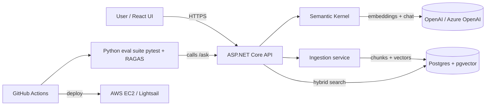

# Plan 1: TestPlan RAG Assistant (build first)

## Goal
A retrieval-augmented Q&A app over a corpus of sample QA test plans (and optionally public VA/DFAS rule documents). Users ask questions and get cited answers. A separate Python eval suite scores answer quality and blocks merges when scores regress.

Why first: it sits on his production C#/.NET skills and matches his strongest-paying fit (P1, stated $140,000-$175,000 base; P2), while the eval harness matches P4 to P6 and his QA background.

Job keywords it proves: C#, .NET 8, ASP.NET Core, Semantic Kernel, Azure OpenAI / OpenAI, RAG, embeddings, chunking, pgvector, hybrid search, tool calling, structured outputs, LLM evals, RAGAS, regression testing, Python, pytest, GitHub Actions, Docker, React.

## Scope
MVP:
- Ingest PDF/Markdown/DOCX test plans, chunk, embed, store in Postgres + pgvector.
- Hybrid retrieval (Postgres full-text + vector similarity, merged with reciprocal rank fusion).
- /ask endpoint returns answer + citations (doc, section, chunk id) as structured JSON.
- Minimal React UI: upload, ask, show answer with clickable citations.
- Python eval suite: golden set of at least 50 Q&A pairs, RAGAS faithfulness, answer relevancy, context precision, plus a retrieval hit-rate@k metric. CI fails on regression below thresholds.
- Deployed on AWS through GitHub Actions.

Stretch:
- Semantic Kernel tool calling (for example "list test cases for feature X", "compare two plans").
- Re-ranking step; chunking strategy experiments with eval results logged.
- Streaming responses (SSE).
- Observability: OpenTelemetry traces, token and latency per request (Langfuse optional).
- Swap provider between OpenAI and Azure OpenAI through config only.
- Auth (Cognito or simple JWT) and per-user document collections.

## Parameters
- Repo: pburt-dev/testplan-rag-assistant (monorepo: /src/api, /src/web, /evals, /infra, /docs)
- Stack: .NET 8 (LTS; consider .NET 10 LTS if released and stable when he starts, decide once and note why in an ADR), ASP.NET Core minimal APIs or controllers, Semantic Kernel 1.x, Npgsql + pgvector extension, PostgreSQL 16+, React 18+ with Vite + TypeScript, Python 3.12, pytest, RAGAS (or DeepEval), Docker + docker compose, GitHub Actions.
- LLM: OpenAI or Azure OpenAI, a small chat model and an embedding model. Pin model names in config. Cap spend with a provider budget limit.
- Corpus: write or generate 200+ synthetic test plans (no employer documents). Optionally add public VA/DFAS PDFs.

Architecture:

Data model (tables):
- documents: id, title, source_type, file_hash, uploaded_at, status
- chunks: id, document_id, ordinal, section_heading, content, token_count, tsvector column, embedding vector(dim)
- queries: id, question, answer, latency_ms, prompt_tokens, completion_tokens, created_at
- query_citations: query_id, chunk_id, rank, score
- eval_runs (optional in DB, otherwise JSON artifacts): id, git_sha, metric, value, created_at

API surface:
- POST /api/documents (multipart upload) -> 202 + document id
- GET /api/documents, GET /api/documents/{id}, DELETE /api/documents/{id}
- POST /api/ask {question, topK?} -> {answer, citations[], usage}
- GET /api/search?q= (retrieval only, used by evals for hit-rate)
- GET /health, GET /ready
- OpenAPI/Swagger published at /swagger

## Milestones (about 1 week each)
1. Setup: repo, README skeleton, ADRs for stack choices, docker compose with Postgres + pgvector, empty API with /health, CI running build + unit tests.
2. Ingestion: TODO parse PDF/MD, chunking strategy (size + overlap as config), store documents and chunks, unit tests for chunker.
3. Embeddings + vector search: TODO embed chunks through Semantic Kernel, store vectors, add index, /api/search vector-only.
4. Hybrid search: TODO full-text tsvector query, reciprocal rank fusion, compare against vector-only on 10 hand-checked queries.
5. Answer generation: TODO prompt template, structured JSON output with citations, /api/ask, refusal when context is insufficient.
6. Golden set + eval harness: TODO write 50+ golden Q&A with expected source chunks, pytest runner, RAGAS metrics, hit-rate@k, results written to JSON.
7. CI gate: TODO eval job in GitHub Actions (on PR, small model, cached), thresholds in config, fail on regression, publish results table as PR comment or artifact.
8. React UI: TODO upload page, ask page, citation viewer, loading and error states.
9. AWS deploy: TODO container images to ECR or GHCR, deploy to one small EC2 or Lightsail instance with docker compose, HTTPS (Caddy or Let's Encrypt), secrets in SSM, deploy workflow on tag.
10. Polish: README, demo video, eval results chart, resume bullets with real numbers, v1.0.0 release.
Stretch weeks after: tool calling, re-ranking, observability.

## Acceptance criteria / definition of done
- One command (docker compose up) runs the full stack locally with seed data.
- /api/ask returns valid JSON with at least one citation for answerable questions and an explicit "not found in documents" for unanswerable ones.
- Hybrid search beats vector-only on hit-rate@5 on the golden set, or the README explains why it does not.
- Eval suite runs in CI and a deliberately broken prompt causes a failing check (show this in the README).
- Unit test coverage of core C# logic at least 70 percent.
- Live demo URL works (or is clearly documented as "start on request" to control cost).
- No secrets in git history (run a secret scanner in CI).

## Testing and CI
- C#: xUnit unit tests (chunker, fusion ranking, prompt builder), integration tests with Testcontainers for .NET against real Postgres + pgvector.
- Python: pytest eval suite; mark slow LLM tests so PRs run a 15 to 20 question subset and nightly runs the full set.
- Frontend: a few Vitest component tests; optional single Playwright smoke test.
- CI jobs: build, lint (dotnet format, ruff, eslint), unit, integration, eval gate, secret scan, docker build. Deploy job on tag only.

## Deployment target
AWS. Cheapest path: one small EC2 (Graviton t4g) or Lightsail instance running docker compose with Postgres in a container and a nightly pg_dump to S3. Optional upgrade: RDS Postgres (supports pgvector) if within free-tier terms. Billing alarm at $10. LLM spend capped at the provider.

## README and demo for recruiters
- Top: one-line pitch, live link, 2-minute video (ask a question, show citations, show CI failing on a bad prompt).
- Architecture diagram, eval results table (metric, threshold, current score), "design decisions" (chunking, hybrid search, why Semantic Kernel), "what I would do next".
- Clear "personal project" label and a sample data note (synthetic test plans only).

## Resume bullet template (fill with real numbers)
**TestPlan RAG Assistant (personal project)** | C#, ASP.NET Core, Semantic Kernel, pgvector, Python
- Built a retrieval-augmented Q&A API over [N] sample QA test plans using Semantic Kernel and Postgres pgvector hybrid search, returning cited answers through a React UI.
- Wrote a Python eval suite with pytest and RAGAS against a [N]-question golden set, and gated GitHub Actions merges on faithfulness and retrieval scores ([metric] [value]).

## Interview Coach practice
Concept checks, drills, and likely questions for this project: [Interview Coach chat](grokbot://app/v1/agent?id=98540b55-e842-4e85-83da-c2392987f3b4)
Topics to be ready for: chunking tradeoffs, embeddings and cosine similarity, hybrid search and RRF, hallucination control, how RAGAS faithfulness works, eval set design, cost and latency control, Semantic Kernel plugins and tool calling.
