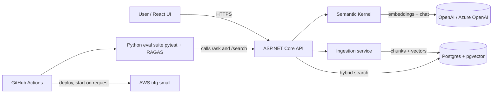

# Plan 1: TestPlan RAG Assistant (build first)

Stack decisions in this plan are settled as of 2026-10-13. Record them in ADRs during milestone 1. Reopen one only when a posting or a measured eval result forces it.

Keep this plan identical in both copies: `project-plans/01-testplan-rag-assistant.md` and `testplan-rag-assistant/PLAN.md`. Update them together.

## Goal
A retrieval-augmented Q&A app over a corpus of sample QA test plans (and optionally public VA/DFAS rule documents). Users ask questions and get cited answers. A separate Python eval suite scores answer quality and blocks merges when scores regress.

Why first: it sits on his production C#/.NET skills and matches his strongest-paying fit (P1, stated $140,000-$175,000 base; P2), while the eval harness matches P4 to P6 and his QA background.

Job keywords it proves: C#, .NET 10, ASP.NET Core, Semantic Kernel, Azure OpenAI / OpenAI, RAG, embeddings, chunking, pgvector, hybrid search, tool calling, structured outputs, LLM evals, RAGAS, regression testing, Python, pytest, GitHub Actions, Docker, React.

Postings still say .NET 8. This project ships on the current LTS. The platform skills transfer. The ADR is the interview answer for the version choice.

## Scope
MVP:
- Ingest Markdown test plans, then PDF once Markdown ingest and its tests are green. Chunk, embed, store in Postgres + pgvector. DOCX is out of the MVP.
- Hybrid retrieval (Postgres full-text + vector similarity, merged with reciprocal rank fusion). Vector search is exact nearest neighbor at MVP corpus size. An ANN index waits until sequential scan is the wrong default.
- /ask endpoint returns answer + citations (doc, section, chunk id, quote) as structured JSON. The server drops any citation whose chunk id was not in the retrieved set.
- Minimal React UI: upload, ask, show answer with clickable citations.
- Python eval suite: golden set of at least 50 Q&A pairs. Pull requests fail on deterministic metrics (JSON schema, citation validity, refusal rate, hit-rate@k). RAGAS runs nightly and fails only when a score drops past a band set in config.
- Deployed on AWS through GitHub Actions. The instance stays stopped between demos.

Stretch:
- DOCX ingest.
- Semantic Kernel tool calling (for example "list test cases for feature X", "compare two plans").
- Re-ranking step; chunking strategy experiments with eval results logged.
- Streaming responses (SSE).
- Observability: OpenTelemetry traces, token and latency per request (Langfuse optional). Per-request latency and token counts are already stored in MVP.
- Swap provider between OpenAI and Azure OpenAI through config only.
- Auth (Cognito or simple JWT) and per-user document collections. The public demo still locks upload down before any of this. See Deployment.

## Parameters
- Repo: pburt-dev/testplan-rag-assistant (monorepo: /src/api, /src/web, /evals, /infra, /docs)
- Solution layout: TestPlanRag.sln, src/api/TestPlanRag.Api (host), src/api/TestPlanRag.Core (chunker, rank fusion, prompt builder), src/api/TestPlanRag.Tests, src/web, evals, infra, docs/adr
- Runtime: .NET 10 LTS, ASP.NET Core minimal APIs. .NET 8 support ends 10 November 2026. .NET 11 is STS, general availability 10 November 2026, supported through 9 November 2028, the same week .NET 10 LTS ends (14 November 2028). .NET 10 is the choice. The next LTS jump, if the repo is still a demo then, is .NET 12 (November 2027).
- OpenAPI: Microsoft.AspNetCore.OpenApi, document at /openapi/v1.json. That is what the .NET 10 webapi template serves.
- Other stack: Semantic Kernel 1.x, Npgsql + pgvector extension, PostgreSQL 16+, React 18+ with Vite + TypeScript, Python 3.12, pytest, RAGAS with the package version pinned (DeepEval only if RAGAS blocks the harness), Docker + docker compose, GitHub Actions.
- LLM: OpenAI or Azure OpenAI. A small chat model and an embedding model. Pin both names in config. Cap spend with a provider budget limit.
- Embeddings: text-embedding-3-small at 1536 dimensions, column type vector(1536). The vector type's HNSW and IVFFlat indexes cap at 2000 dimensions. text-embedding-3-large defaults to 3072 and does not fit that index. A later model change updates the ADR, the column width, and a re-embed of every chunk together. Local secrets go in dotnet user-secrets. .env.example lists the keys and never holds real values.
- Corpus: about 10 hand-written Markdown plans while the pipeline is built (weeks 2 to 5). Grow to 200+ synthetic plans before the golden set is frozen. No employer documents. Optionally add public VA/DFAS PDFs after PDF ingest works.

Architecture:

Data model (tables):
- documents: id, title, source_type, file_hash (unique), uploaded_at, status, error. Status is one of uploaded, chunked, embedded, ready, failed. A second upload of the same file_hash returns the existing document.
- chunks: id, document_id, ordinal, section_heading, content, token_count, tsvector column, embedding vector(1536) null until embedded
- queries: id, question, answer, latency_ms, prompt_tokens, completion_tokens, created_at. /api/ask writes this row.
- query_citations: query_id, chunk_id, rank, score. /api/ask writes these rows, and only for chunk ids that were actually retrieved.
- eval_runs (optional in DB, otherwise JSON artifacts): id, git_sha, metric, value, created_at

Golden-set row (JSON, not a chunk id):
- id, question, answerable (bool), document_title, section_heading, source_quote
- Hit-rate matches title + section + quote, so a chunk-size change does not invalidate the set
- Include unanswerable questions. Refusal rate is a first-class metric.

API surface:
- POST /api/documents (multipart upload) -> 202 + document id. Client polls GET /api/documents/{id} until ready or failed.
- GET /api/documents, GET /api/documents/{id}, DELETE /api/documents/{id} (chunks cascade)
- POST /api/ask {question, topK?} -> {answer, citations[], usage}. Default topK is 5, max 10. Citations that were not retrieved are removed before the response is returned. Empty retrieval, or every citation stripped, returns an explicit "not found in documents".
- GET /api/search?q= (retrieval only, used by evals for hit-rate)
- GET /health (process is up), GET /ready (Postgres answers)
- OpenAPI document at /openapi/v1.json
- Demo deployment: seeded corpus, upload off or gated by one shared API key, /api/ask rate-limited. Open upload on a public URL spends embedding money for anyone who finds it.

## Milestones (about 1 week each)
1. Setup: repo hygiene (.gitignore covering bin/ and obj/, MIT LICENSE, .env.example, dotnet user-secrets), README skeleton, solution with Api, Core, and Tests, ADRs for the runtime and for the model names plus vector(1536), docker compose with the pgvector/pgvector Postgres 16 image, empty API with /health and /ready, weather-forecast sample removed, CI running build + unit tests.
2. Ingestion: TODO Markdown parse, chunk on headings and test-case boundaries, then apply size and overlap from config. Fixed-size windows are the fallback. Store documents and chunks. Status moves uploaded to chunked. Duplicate file_hash returns the existing document. Chunker unit tests in TestPlanRag.Core. About 10 hand-written plans as fixtures. PDF parsing starts only after Markdown ingest and its tests are green.
3. Embeddings + vector search: TODO embed chunks through Semantic Kernel, store vector(1536), status moves to embedded then ready, re-embed any chunk whose vector is null. Exact nearest neighbor. /api/search vector-only. Testcontainers integration tests use the pgvector/pgvector image.
4. Hybrid search: TODO full-text tsvector query, reciprocal rank fusion, compare against vector-only on 10 hand-checked queries. Leave HNSW off and record why in the README. Add it only after the corpus is large enough that exact search is the wrong default.
5. Answer generation: TODO prompt template, structured JSON output with citations (doc, section, chunk id, quote), /api/ask, server-side citation check, explicit "not found in documents" when context is insufficient or no citation survives. Persist queries and query_citations.
6. Golden set + eval harness: TODO grow the corpus to 200+ plans, then freeze 50+ golden rows in the schema above, including unanswerable questions. pytest runner, deterministic metrics, RAGAS metrics with the version pinned, results written to JSON.
7. CI gate: TODO pull-request job runs a 15 to 20 question subset and fails on schema, citation validity, refusal rate, or hit-rate@k. A deliberately broken prompt fails this gate, and the README shows that run. Nightly job runs the full set plus RAGAS and fails only when a score drops past the band in config. Publish the results table as a PR comment or artifact.
8. React UI: TODO upload page, ask page, citation viewer, loading and error states. Upload page respects the same auth rule the demo uses.
9. AWS deploy: TODO images to ECR or GHCR. GitHub-hosted runners are amd64, so CI builds and tests that arch. The deploy image is linux/arm64. One t4g.small (2 GB) or the Lightsail equivalent, docker compose, Postgres in a container, nightly pg_dump to S3, HTTPS (Caddy or Let's Encrypt), secrets in SSM, deploy workflow on tag. A 0.5 GB instance is too small for Postgres plus the API. Instance stays stopped between demos. Billing alarm at $10 on day one. Seeded corpus, upload locked, /api/ask rate-limited.
10. Polish: README, demo video, eval results chart, resume bullets with real numbers, v1.0.0 release.
Stretch weeks after: DOCX, tool calling, re-ranking, observability, HNSW if the corpus has earned it.

## Acceptance criteria / definition of done
- One command (docker compose up) runs the full stack locally with seed data.
- /api/ask returns valid JSON with at least one retrieved citation for answerable questions, and an explicit "not found in documents" for unanswerable ones. A citation the model invented does not appear in the response.
- Hybrid search beats vector-only on hit-rate@5 on the golden set, or the README explains why it does not.
- The pull-request eval gate runs in CI. A deliberately broken prompt fails it, and the README shows that failure. The nightly RAGAS job is separate and banded.
- Unit test coverage of TestPlanRag.Core is at least 70 percent.
- The live demo is documented as start-on-request, serves the seeded corpus, and does not accept anonymous uploads.
- No secrets in git history (secret scanner in CI). bin/ and obj/ are gitignored.

## Testing and CI
- C#: xUnit unit tests against TestPlanRag.Core (chunker, fusion ranking, prompt builder, citation filter). Integration tests with Testcontainers for .NET against the pgvector/pgvector image, not the stock Postgres image.
- Python: pytest eval suite. Pull requests run a 15 to 20 question deterministic subset. Nightly runs the full set and RAGAS. RAGAS version is pinned. Golden rows key off title, section, and quote.
- Frontend: a few Vitest component tests; optional single Playwright smoke test.
- CI jobs: build, lint (dotnet format, ruff, eslint), unit, integration, deterministic eval gate, secret scan, docker build. RAGAS nightly. Deploy job on tag only.

## Deployment target
AWS. One t4g.small (2 GB, Graviton) or the Lightsail equivalent, docker compose, Postgres in a container, nightly pg_dump to S3. The instance stays stopped between demos. Stopping it leaves the EBS volume billed, which is expected. The $10 billing alarm is there so a forgotten running instance shows up. Check current AWS Free Tier terms before creating anything. RDS Postgres (pgvector) is an optional upgrade only if it fits those terms. LLM spend is capped at the provider. Demo upload is off or behind one shared API key.

## README and demo for recruiters
- Top: one-line pitch, how to start the demo, 2-minute video (ask a question, show citations, show CI failing on a bad prompt).
- Architecture diagram, eval results table (metric, threshold, current score, and whether the gate is pull-request or nightly), "design decisions" (why .NET 10, chunking, exact search at this corpus size, hybrid search, server-side citation checks, why Semantic Kernel), "what I would do next".
- Clear "personal project" label and a sample data note (synthetic test plans only).

## Resume bullet template (fill with real numbers)
**TestPlan RAG Assistant (personal project)** | C#, ASP.NET Core, .NET 10, Semantic Kernel, pgvector, Python
- Built a retrieval-augmented Q&A API over [N] sample QA test plans using Semantic Kernel and Postgres pgvector hybrid search, returning cited answers through a React UI.
- Wrote a Python eval suite with pytest and RAGAS against a [N]-question golden set, and gated GitHub Actions merges on faithfulness and retrieval scores ([metric] [value]).

## Interview Coach practice
Concept checks, drills, and likely questions for this project: [Interview Coach chat](grokbot://app/v1/agent?id=98540b55-e842-4e85-83da-c2392987f3b4)
Topics to be ready for: why .NET 10 rather than 8 or 11, chunking tradeoffs, embeddings and cosine similarity, why exact search at a few thousand chunks, hybrid search and RRF, server-side citation checks, how RAGAS faithfulness works and why it is nightly, eval set design (stable quotes, unanswerable questions), cost and latency control, Semantic Kernel plugins and tool calling.
